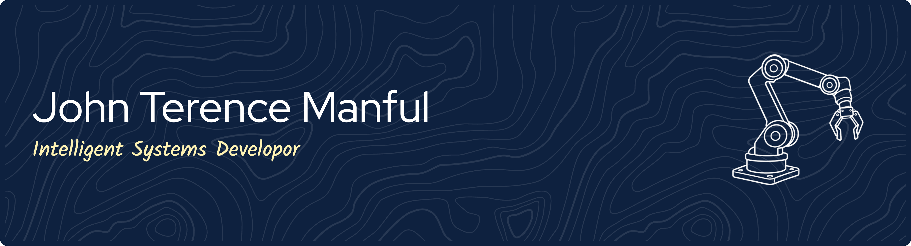
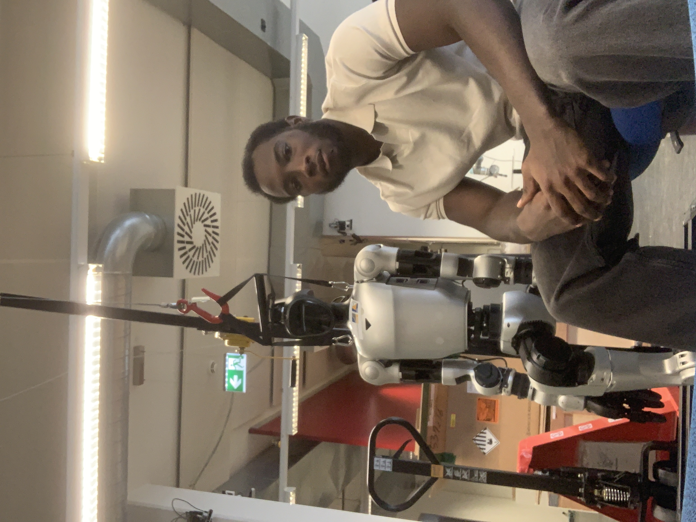

---

# Hi, I'm John 

<table>
  <tr>
    <td width="65%" valign="middle">

I'm an MSc student in Computer Science at the University of Bonn, Germany.

My interests lie at the intersection of robotics, autonomous systems, and artificial intelligence. I enjoy developing intelligent systems that connect software with the physical world — from robot modeling and simulation to autonomous navigation, perception, and vision-language-action (VLA) models.

Alongside robotics, I bring professional experience in full-stack and backend engineering, building APIs, scalable services, and production-grade software systems.

- 🤖 **Primary focus:** Robotics and autonomous systems
- 🧠 **Interests:** AI, computer vision, and intelligent manipulation
- ⚙️ **Software engineering:** C++, Python, Java, Spring Boot, and React
- 🔬 **Research:** Machine learning and intelligent systems
- 🌍 **Based in:** Bonn, Germany
- 🇩🇪 **Languages:** English; German (B1.2, currently learning)

</td>
<td width="35%" align="center" valign="middle">

<!-- Replace this placeholder with your photo -->

</td>
</tr>
</table>

---

## 🎓 Education

**MSc in Computer Science (2026 - Present)**  
University of Bonn, Germany

**Computer Science (2020 - 2024)**  
Ashesi University, Ghana

---

## 🛠️ Technical Skills

My technical toolkit spans robotics, programming, AI-related technologies, and software engineering. 

### Programming Languages

### Backend Development

**Experience:** RESTful API development, authentication and authorization, database query optimization, testing, and backend service development.

### Frontend Development

**Experience:** Responsive React components, frontend development, and unit and integration testing.

### AI & Machine Learning

**Technologies and areas:** OpenCV, computer vision, SLAM, machine learning, and vision-language-action models.

### Robotics & Autonomous Systems

**Robotics tools:** ROS 2, Nav2, SLAM Toolbox, RViz2, Gazebo, and Linux environments (Ubuntu/Debian).

**Areas:** Robot modeling and simulation, autonomous navigation, perception, and manipulation.

### Data Analytics

Interested in data-driven approaches to machine learning, perception, and intelligent systems.

### DevOps & Development Tools

**Tools and platforms:** Git, Docker, Microsoft Azure, AWS S3, Linux, CI/CD pipelines, and collaborative Agile development (Jira).

---

## 💼 Professional Experience

### Software Engineer | Turntabl

*August 2025 – March 2026*

Worked across full-stack engineering, backend systems, and production-grade software in an Agile environment.

- **Bonarda HR:** Built RESTful APIs using Spring Boot and responsive React components for an HR management platform, raising frontend test coverage from baseline to 85% through structured unit and integration testing.
- **CircularTech:** Developed backend services for a waste management platform serving Makola market, designing scalable APIs and optimizing database queries for performance and reliability.
- **Trading Engine:** Contributed to a trading engine by implementing concurrent processing patterns and supporting transactional integrity within an event-driven architecture.
- **Engineering Practices:** Collaborated through sprint planning, code reviews, Git version control, and CI/CD pipelines while applying clean code, SOLID principles, and system design best practices.

**Technologies:** Java, Spring Boot, React, REST APIs, SQL/database technologies, Git, CI/CD.

### Software Engineer | Ashesi University

*September 2024 – August 2025*

Developed an institutional data-sharing platform using Python, Django REST Framework, and Microsoft Azure.

- Built and deployed a secure dataset-sharing platform on Azure and Linux server environments.
- Implemented JWT authentication and structured permission controls for external REST API consumers.
- Integrated AWS S3 for scalable file storage.
- Wrote unit and integration tests to support API reliability and data accuracy.

**Technologies:** Python, Django REST Framework, REST APIs, JWT, Microsoft Azure, AWS S3, Linux.

---

## 🚀 Featured Projects

### 🦾 VLA Models for Bimanual Manipulation

**Vision-Language-Action Models | Robotic Manipulation**

Fine-tuned and compared π0.5 and X-VLA on manipulation tasks including brick placement and bottle opening, with a FastAPI policy server supporting real-robot and MuJoCo rollouts.

**Focus:** Vision-language-action models, robotic manipulation, policy serving, and simulation.

**Repository:** Coming soon.

### 🤖 [Autonomous Robotics & AI Platform](https://github.com/jt-manful/Automous-Robot-and-AI-Platform)

A modular ROS 2 Jazzy project focused on developing an autonomous robotics system incrementally, with scope for perception, object detection, tracking, navigation, and manipulation.

**Focus:** ROS 2, modular robotics software, Docker-based development, and AI integration.

[Explore the repository →](https://github.com/jt-manful/Automous-Robot-and-AI-Platform)

### 🚗 [ROS 2 Mobile Robot with Arm](https://github.com/jt-manful/ros2-mobile-robot)

A simulated mobile robot equipped with a two-axis robotic arm, developed using ROS 2.

The project explores robot modeling, simulation, visualization, and the software components needed to bring mobile manipulation systems together.

**Focus:** ROS 2, URDF/Xacro, Gazebo, RViz, and robot simulation.

[Explore the repository →](https://github.com/jt-manful/ros2-mobile-robot)

---

## 🔬 Research & Community

### Research Publication

**Machine Learning for Detecting Fraudulent Cryptocurrency Platforms**

Research applying machine learning to the detection of fraudulent cryptocurrency platforms, published through IEEE.

[Read the publication on IEEE Xplore](https://doi.org/10.1109/ICAST61769.2024.10856435)

### 🤖 Mobile Robotics Hackathon — TU Dresden - October 2026

Participating in the robotics community through the Mobile Robotics Hackathon.

- **Event information:** [mobile-robotics.eu](https://mobile-robotics.eu/)
- **Project repository:** [Combined System](https://github.com/MOBILE-ROBOTICS-HACKATHON/combined_system)

---

## 🌱 Beyond the Code

I'm interested in how robotics, AI, and software engineering can be combined to build useful, reliable intelligent systems.

I enjoy collaborating on challenging technical projects, learning new tools, and turning ideas into practical implementations. I'm open to opportunities in robotics, autonomous systems, AI, and software engineering.

I'm also learning German and currently working at the B1 level.

---

## 🤝 Let's Connect

